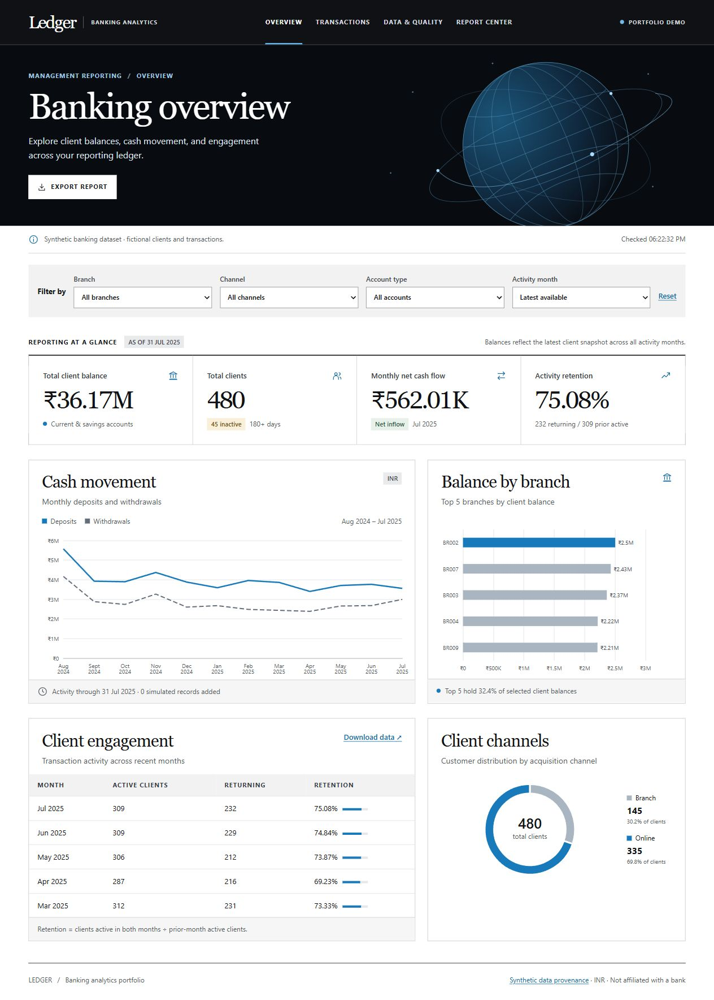
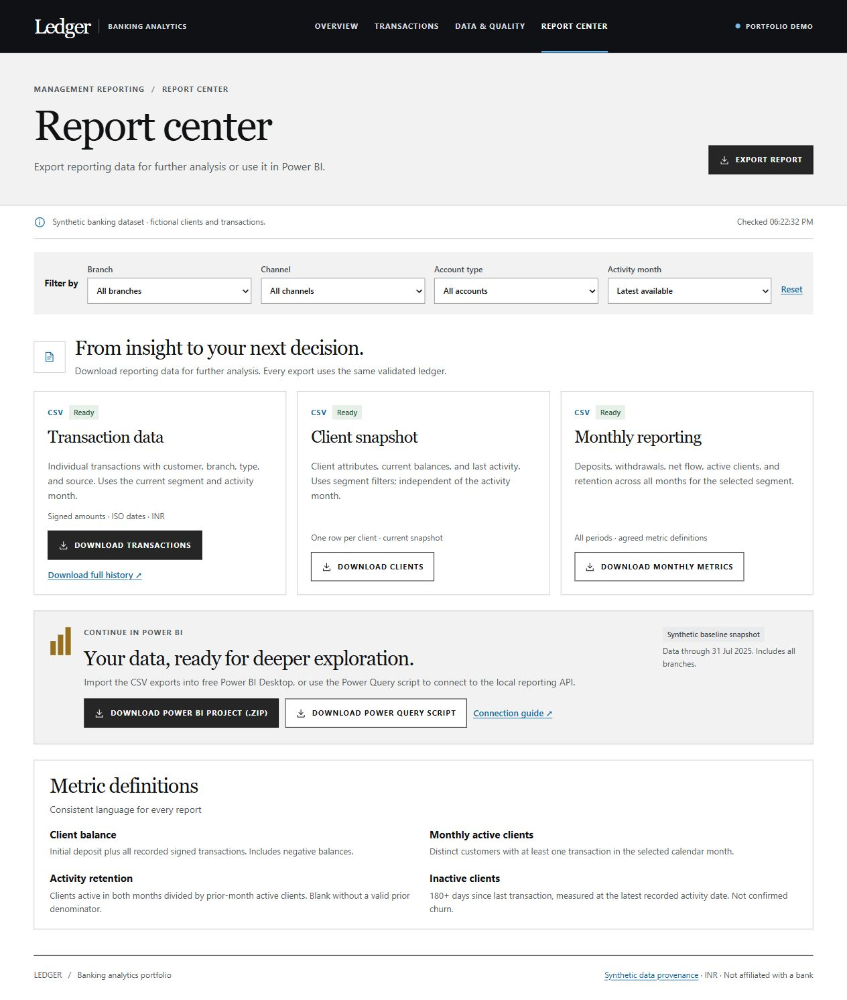
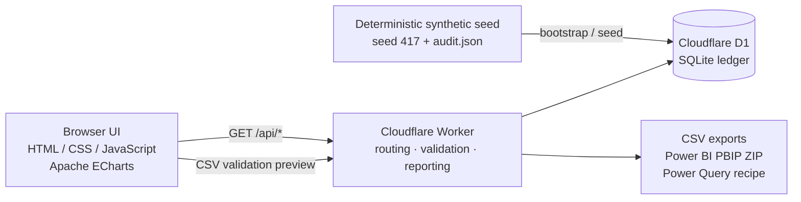
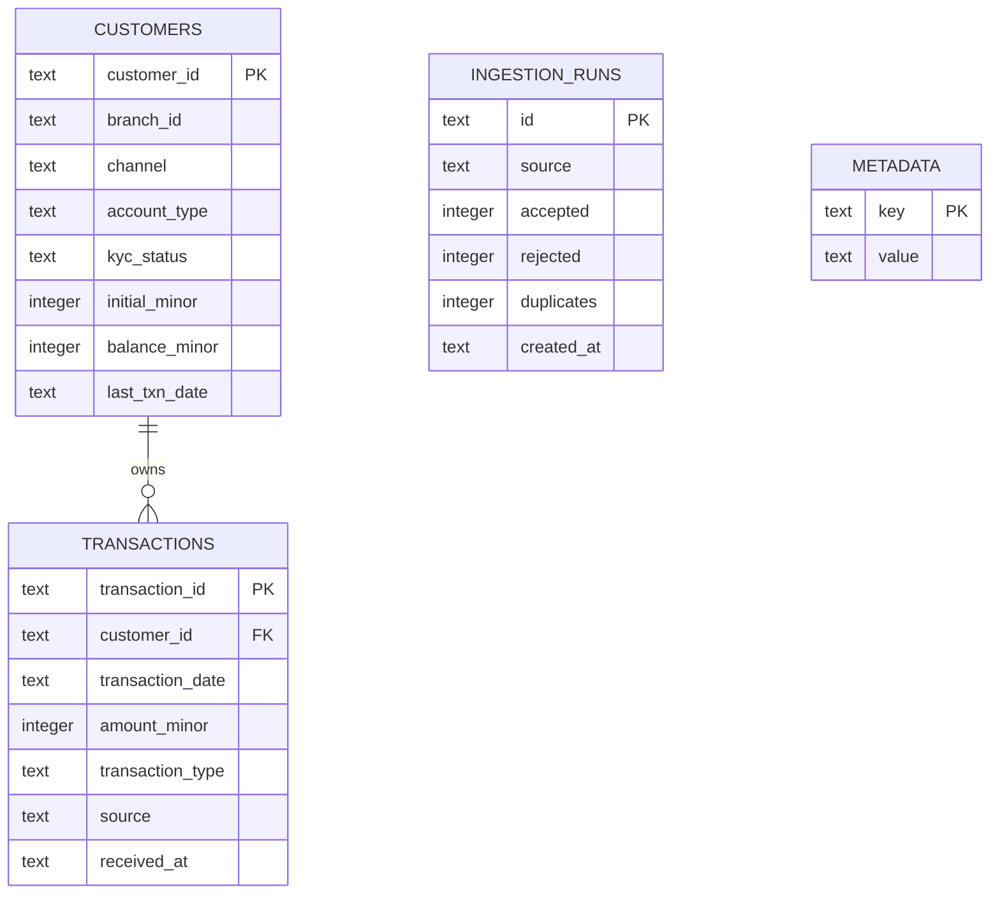

# Ledger | Banking analytics

Ledger is a deployed, full-stack banking analytics product for a reporting or relationship-management team. A browser interface uses Apache ECharts to display SQL-backed balances, cash flow, engagement, and data quality. The same Worker API runs against Cloudflare D1 on the web and SQLite locally.

**Live demo:** [ledger-banking-analytics.ledger-banking-analytics.workers.dev](https://ledger-banking-analytics.ledger-banking-analytics.workers.dev/)  
**Source:** [github.com/LuqmanCSE/ledger-banking-analytics](https://github.com/LuqmanCSE/ledger-banking-analytics)

All clients, branches and transactions are fictional. This repository contains no real personal, banking or market data. The public deployment is a read-only demo: it permits validation previews, queries and exports, while persistent writes and simulated transactions are disabled.

## Product preview

The screenshots below were captured from the deployed Cloudflare Worker using the seeded baseline (480 fictional clients, 18 branches and 9,993 transactions through 31 July 2025).





## Architecture



The browser and Worker share the same reporting definitions. This keeps dashboard totals, downloaded CSVs and the Power BI baseline aligned instead of maintaining separate calculations for each surface.

## Database model



Amounts are stored as integer minor units and rendered as INR. The `transaction_balance` trigger updates the customer snapshot after a committed transaction. Uploads are checked for known clients, valid dates, signed amounts and unique transaction IDs; a failed batch is not partially committed.

## API surface

| Method | Endpoint | Purpose |
| --- | --- | --- |
| `GET` | `/api/status` | Dataset readiness, record count and public-demo state |
| `GET` | `/api/dashboard` | Filtered balances, cash flow, retention, channels and quality metrics |
| `GET` | `/api/transactions` | Paginated transaction ledger with source and type filters |
| `POST` | `/api/validate` | Validate a CSV without writing it; this is the public upload path |
| `GET` | `/api/export?kind=transactions\|customers\|monthly` | Download formula-safe reporting CSVs |
| `GET` | `/api/audit` | Seed hash, provenance and independently calculated benchmarks |
| `GET` | `/api/powerbi/download` | Download the generated Power BI Project (`.pbip.zip`) |
| `GET` | `/api/powerquery` | Download the Power Query connection recipe |
| `GET` | `/api/template` / `/api/sample` | Download an upload template or fictional validation sample |

`POST /api/transactions`, `POST /api/simulate` and `POST /api/setup` remain available for local development, but are intentionally rejected by the public deployment until authentication is added.

## Try the portfolio workflow

1. In **Overview**, filter by branch or channel and compare cash flow and activity retention.
2. In **Data & quality**, select **Use sample batch**, then **Validate sample** on the public demo. The four-row batch exercises accepted transactions, an unknown client, and an invalid date. Public mode previews results against the real validation logic.
3. In **Report center**, export filtered CSV data or open the Power BI baseline snapshot. The report covers monthly cash flow, month-to-month retention, and client balances by branch.

In local mode, the same sample can be committed. Accepted rows, balance updates, and the ingestion audit commit together. Re-importing identical rows demonstrates idempotency.

## Run locally

Requires Node.js 24+ and npm. Python 3 is only needed to regenerate the synthetic dataset or package the portable release.

```powershell
npm ci
npm run build
npm test
npm start
```

Open http://127.0.0.1:8787. The first load seeds the local synthetic database. It uses `.local/ledger-synthetic-v1.sqlite`. Restarting preserves local imports.

## Deploy on Cloudflare Workers Free

Use the clean release ZIP as a starting point for a fresh public repository. The app uses the existing Worker/D1 stack and needs no paid Power BI service or custom domain. Cloudflare provides a `workers.dev` URL. Usage is subject to the [Workers free limits](https://developers.cloudflare.com/workers/platform/limits/) and [D1 free limits](https://developers.cloudflare.com/d1/platform/pricing/).

1. Extract the release ZIP and open a terminal in the extracted `ledger-banking-analytics` folder. Run:

   ```powershell
   npm ci
   npm run build
   npm test
   npm run seed:d1
   npx --yes wrangler@4.159.0 login
   npx --yes wrangler@4.159.0 d1 create ledger-portfolio
   ```

2. In `wrangler.jsonc`, set `database_id` to the UUID from `d1 create`. Keep the `DB` binding, `drizzle` migrations directory, and `PUBLIC_DEMO` set to `"1"`. Use the new database for this release.
3. Apply the schema, seed the synthetic rows, and deploy:

   ```powershell
   npx --yes wrangler@4.159.0 d1 migrations apply DB --remote
   npx --yes wrangler@4.159.0 d1 execute DB --remote --file outputs/seed-d1.sql
   npx --yes wrangler@4.159.0 deploy
   ```

4. Open the printed URL. The overview should show **480 clients** and **75.08% July 2025 activity retention**. Check the sample preview and report download before sharing the URL.

The public Worker rejects persistent imports, simulated writes, and browser-initiated seeding. It accepts CSV validation previews, queries, and exports. The public baseline is fixed and the browser does not poll it in the background.

### Why Cloudflare instead of Netlify or Vercel?

Ledger is not only a static page: the Worker serves the API, validation logic, CSV exports, and the D1/SQLite-backed reporting queries. Cloudflare Workers + D1 keeps those pieces together on a free tier. Netlify or Vercel can host the browser bundle, but the API would need to be rewritten as functions and the database moved to a separate service such as Supabase or Neon. That is a valid future architecture, but it adds another account and another failure point without improving this portfolio demo. The current deployment is the smallest honest full-stack path; a static Netlify/Vercel preview can be added later if you want a second hosting link.

To rehearse the deployment without a Cloudflare account, use `--local` in place of both `--remote` flags against the placeholder database ID and run `npx --yes wrangler@4.159.0 dev`.

## Power BI

- **Download report** in Report center serves the actual build artifact. A Power BI project ZIP contains `Ledger.pbip`, its report definition, and its semantic model. Unzip it, open the project in Power BI Desktop, and choose **Refresh now** when the banner says that tables have incomplete or no data. PBIP stores the model/query definition rather than a cached VertiPaq result, so the first open can show `--` until refresh completes. After refresh, the cards should show about **480 clients**, **₹36M** balance, and **₹14M** net cash flow. The ZIP is already a complete portfolio artifact; converting it to a single `.pbix` file is optional. If you want that format, use **File → Save as → Power BI Desktop file (.pbix)**. PBIP is a [Power BI Desktop project format](https://learn.microsoft.com/en-us/power-bi/developer/projects/projects-overview).
- A native `reports/Ledger.pbix`, when present at build time, is served in preference to the project ZIP. Build again after adding or updating it.
- The report is an all-branches baseline snapshot through **31 July 2025**. It is independent of the browser's current filters or private imports. The `PowerQuery.m` download is a separate recipe for importing the API's transaction CSV into Power BI. Set `BaseUrl` to your local or public Worker origin.
- Rebuild the report source with `npm run build:powerbi`. The generator uses the same seeded SQLite database and SQL reporting function as the dashboard. Package the generated project before opening it in Desktop with `python -m zipfile -c reports/Ledger.pbip.zip outputs/powerbi`.

## Wealth-management roadmap

Ledger is intentionally scoped as a banking reporting foundation, not a production advisory system. The next increments are documented here so the project has a credible path toward relationship-manager and wealth-management workflows:

| Phase | Capability | Why it matters |
| --- | --- | --- |
| Next | AUM and portfolio snapshots | Moves from account balances to investable-asset monitoring |
| Next | Asset allocation by client and household | Supports concentration and diversification review |
| Next | Synthetic risk bands and benchmark returns | Adds suitability-oriented portfolio context without using real client data |
| Later | Relationship-manager notes and follow-up queue | Connects analytics to an actionable client workflow |
| Later | Suitability checks, role-based access and audit trails | Adds the controls expected of a production financial system |

These are planned capabilities, not claims about the current demo. The current release demonstrates the data-quality, reporting and export foundation needed to build them safely.

## Verification checklist

Run the same checks locally before sharing the repository or demo link:

```powershell
npm ci
npm run build
npm test
npm start
```

Then open `http://127.0.0.1:8787` and verify:

1. Overview loads 480 clients and the baseline metrics.
2. Data & quality → **Use sample batch** → **Validate sample** returns accepted and rejected rows without changing the public baseline.
3. Report center downloads transaction, client and monthly CSVs.
4. Report center exposes the Power BI Project ZIP and Power Query script.
5. `GET /api/status`, `GET /api/audit` and `GET /api/powerbi` return successful JSON.

For the deployed demo, the same checks can be run against:

```powershell
$base = "https://ledger-banking-analytics.ledger-banking-analytics.workers.dev"
Invoke-RestMethod "$base/api/status"
Invoke-RestMethod "$base/api/dashboard"
Invoke-RestMethod "$base/api/powerbi"
Invoke-WebRequest "$base/api/powerbi/download" -OutFile "Ledger.pbip.zip"
```

## Data and metric definitions

The baseline is generated from seed 417 by `scripts/prepare_data.py`. It contains 480 fictional clients, 18 fictional branches, and 9,993 signed INR transactions from August 2024 to July 2025. Run `npm run prepare:data` to reproduce it. `data/audit.json` records the seed hash, integrity checks, and independently calculated benchmarks.

Client balance equals initial deposit plus signed transactions. Inactivity is 180 days since the last transaction relative to the ledger's reporting date. Monthly activity retention is the number of clients active in both months divided by the prior month's active clients. Filters apply to both sides of the retention calculation. Snapshot balances use client filters and include all activity months.

## Implementation

- `public/` contains the interface, filters, and charts.
- `worker/index.js` routes HTTP requests. `worker/core.js` defines reporting, validation, and exports.
- `drizzle/0000_ledger.sql` defines keys, constraints, indexes, and an insert trigger that updates balances.
- `npm test` covers report reconciliation, cross-origin writes, idempotent imports, rollback, public previews, filtered exports, and report availability.
- `npm run package:release` creates a clean source ZIP in `outputs/` for a fresh public repository.

See [attribution](ATTRIBUTION.md) for the prototype source and release provenance.
